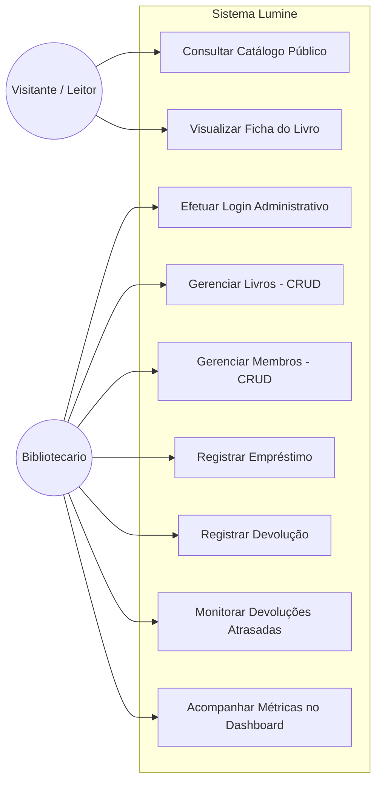
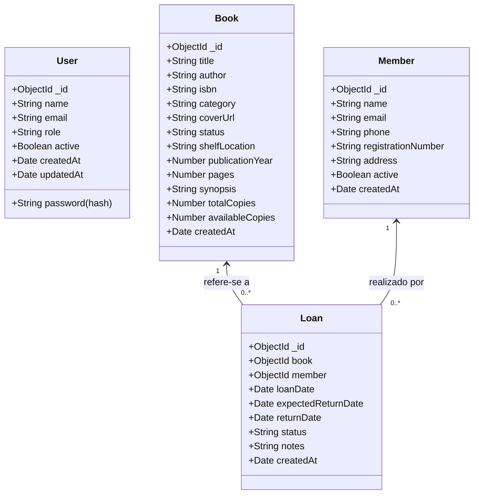
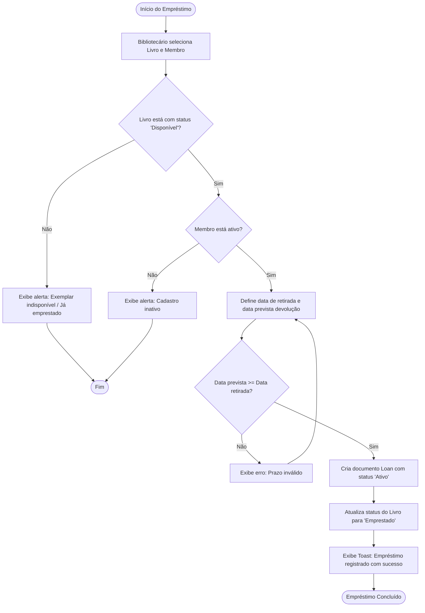
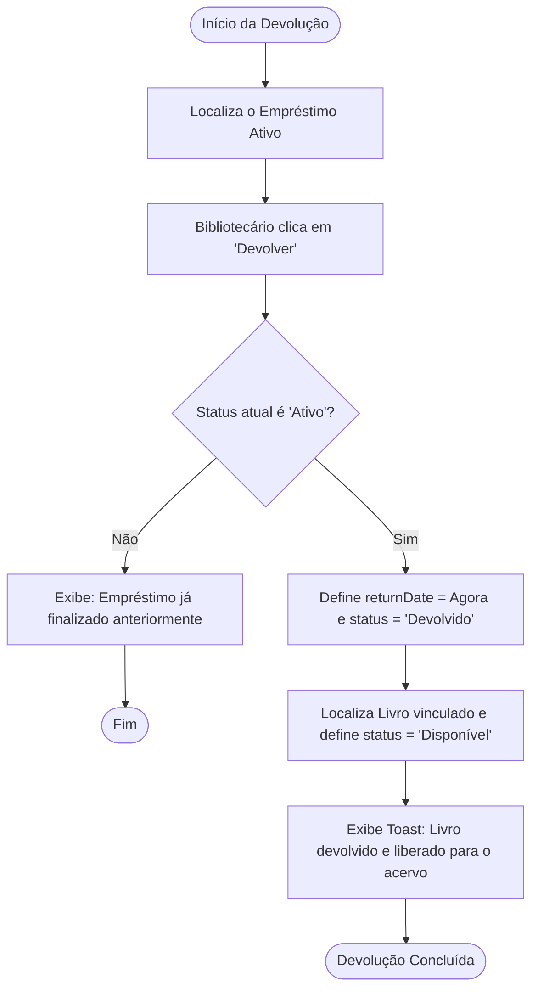

# DOCUMENTAÇÃO TÉCNICA DO SISTEMA LUMINE
**Lumine — Sistema Comunitário de Gestão Bibliotecária**  
*Versão 1.0 (MVP) · Next.js 16 (App Router) · MongoDB & Mongoose · TypeScript · SCSS*

---

## 01 — Visão Geral

### 1.1. O Problema
Antes do Lumine, a gestão do acervo literário da biblioteca comunitária "Ler é Viver" era realizada por meio de anotações manuais em fichas físicas de papel e cadernos de registro. Esse modelo gerava graves fragilidades operacionais:
- **Dificuldade na localização rápida de títulos e autores** por parte dos leitores e da vizinhança.
- **Risco de perdas de exemplares** por ausência de rastreamento confiável de quem retirou qual livro.
- **Inexistência de controle automatizado de prazos**, gerando atrasos crônicos na devolução e acúmulo de livros retidos sem visibilidade.
- **Desgaste das fichas cadastrais** e redundância no registro de informações.

### 1.2. Objetivo do Projeto
Desenvolver uma solução web full-stack moderna, intuitiva, segura e com identidade visual acolhedora (editorial vintage) que substitua o controle manual de livros, membros, empréstimos e devoluções, garantindo que o acervo circule de forma justa, transparente e democrática pela comunidade.

### 1.3. Público-Alvo
1. **Visitantes e Moradores da Comunidade**: Pessoas de todas as idades que desejam explorar o acervo, pesquisar obras por autor ou título e verificar a disponibilidade física dos exemplares no balcão sem necessidade de login prévio ou burocracia.
2. **Bibliotecário / Voluntário**: Operador administrativo autenticado que realiza o cadastro do acervo, registro e atualização de leitores, operações de retirada e devolução de livros, além do acompanhamento ativo de empréstimos em atraso.

### 1.4. Escopo do MVP (Minimum Viable Product)
O sistema foca rigorosamente nos fluxos essenciais de gestão bibliotecária comunitária, eliminando complexidades desnecessárias:
- **Incluído no Escopo**: Catálogo público com busca em tempo real e visualização de fichas catalográficas; login administrativo seguro via JWT e Bcrypt; CRUD completo de livros com restrição de exclusão para exemplares emprestados; CRUD completo de membros com restrição de exclusão para leitores com pendências; registro de empréstimos com validação de disponibilidade e atualização automática de status; devolução ágil em 1 clique com restauração do status para "Disponível"; painel exclusivo de atrasos calculados dinamicamente; dashboard executivo com indicadores do acervo.
- **Fora do Escopo**: Área logada para membros/visitantes, cobrança de multas financeiras, gateway de pagamento, emissão de relatórios fiscais ou reservas remotas com fila de espera.

---

## 02 — Requisitos

### 2.1. Requisitos Funcionais (RF)
- **RF01 — Consulta Pública do Acervo**: Permitir a qualquer visitante buscar livros por título, autor, categoria ou ISBN, visualizando capa, disponibilidade e detalhes completos.
- **RF02 — Autenticação do Bibliotecário**: Permitir o acesso seguro ao painel administrativo via e-mail e senha com geração de token JWT.
- **RF03 — Gerenciamento de Livros (CRUD)**: Cadastrar, listar, editar, visualizar e excluir livros com campos como título, autor, ISBN (único), categoria, estante, ano, páginas e sinopse.
- **RF04 — Gerenciamento de Membros (CRUD)**: Cadastrar, listar, editar e excluir membros com nome, e-mail (único), telefone, número de registro/matrícula e endereço.
- **RF05 — Registro de Empréstimos**: Registrar a saída de um exemplar disponível para um membro leitor ativo, definindo data de retirada e data prevista de devolução.
- **RF06 — Atualização Automática do Status do Livro**: Ao emprestar, alterar o livro para "Emprestado"; ao registrar devolução, restaurar automaticamente para "Disponível".
- **RF07 — Impedimento de Empréstimo Duplicado**: Rejeitar novo empréstimo de um livro que já esteja emprestado.
- **RF08 — Registro de Devoluções**: Finalizar empréstimo ativo registrando a data de retorno e liberando o exemplar no acervo.
- **RF09 — Identificação Dinâmica de Atrasos**: Listar todos os empréstimos ativos com data prevista anterior à data atual, calculando os dias de atraso em tempo real.
- **RF10 — Dashboard com Indicadores**: Exibir total de livros, membros cadastrados, empréstimos ativos, devoluções atrasadas e empréstimos recentes.

### 2.2. Requisitos Não Funcionais (RNF)
- **RNF01 — Segurança de Senhas**: Utilizar algoritmo de hash Bcrypt com salt rounds adequados (10) para armazenamento seguro de credenciais no banco.
- **RNF02 — Proteção de Sessão**: Implementar autenticação baseada em JWT com transporte seguro via Cookie HTTP-Only e cabeçalho `Authorization: Bearer`.
- **RNF03 — Proteção de Rotas no Servidor**: Validar permissões e tokens no servidor via Next.js Middleware e guards em todas as APIs administrativas.
- **RNF04 — Identidade Visual e Responsividade**: Interface compatível com desktop, tablets e celulares, seguindo a paleta de cores editorial (#432818, #99582A, #BB9457, #FFE6A7, Creme Linho) e tipografia Playfair Display e Plus Jakarta Sans.
- **RNF05 — Desempenho e Persistência**: Conexão com MongoDB via Mongoose com reaproveitamento de instâncias e índices de consulta.

### 2.3. Regras de Negócio (RN)
- **RN01 (Disponibilidade para Empréstimo)**: Apenas livros com status "Disponível" podem ser emprestados.
- **RN02 (Integridade Referencial na Exclusão de Livro)**: É estritamente proibido excluir um livro que possua empréstimos com status "Ativo".
- **RN03 (Integridade Referencial na Exclusão de Membro)**: É estritamente proibido excluir um membro leitor que possua livros pendentes de devolução.
- **RN04 (Unicidade de Identificadores)**: O código ISBN de cada livro e o e-mail de cada membro devem ser únicos no banco de dados.
- **RN05 (Coerência de Prazos)**: A data prevista de devolução deve ser igual ou superior à data de realização do empréstimo.
- **RN06 (Cálculo Automático de Atraso)**: O cálculo de dias de atraso deve ser dinâmico (`dias = max(1, floor((hoje - dataPrevista) / 1 dia))`), nunca exigindo rotinas manuais de atualização de status para saber o atraso.

### 2.4. Critérios de Aceitação
- Visitantes conseguem filtrar o catálogo e visualizar modais de detalhes sem nenhuma solicitação de login.
- O acesso a qualquer rota `/admin/*` sem cookie válido redireciona imediatamente para `/login`.
- A tentativa de deletar um livro emprestado retorna status HTTP 400 com mensagem clara explicando o motivo do bloqueio.
- Ao clicar em "Devolver", a tabela de empréstimos e o catálogo público passam a refletir o status "Disponível" instantaneamente.

---

## 03 — Planejamento e Riscos

### 3.1. Etapas do Desenvolvimento
1. **Diagnóstico & Setup Inicial**: Instalação do Next.js 16, Mongoose, Bcryptjs, JsonWebToken e Sass.
2. **Modelagem de Dados**: Definição dos Schemas Mongoose (`User`, `Book`, `Member`, `Loan`) com tipos TypeScript e índices.
3. **Mecanismo de Autenticação**: Implementação de Bcrypt, JWT, utilitários de cookie e middleware de proteção.
4. **Camada de APIs REST**: Construção dos endpoints CRUD com validações no servidor e controle transacional de status.
5. **Carga Inicial (Seed)**: Desenvolvimento de script para inserção de dados realistas e credenciais do bibliotecário.
6. **Interface Frontend**: Construção do catálogo público, login, dashboard, telas de CRUD e modal de detalhes baseados no protótipo Stitch.
7. **Validação & Testes**: Execução de scripts de teste automatizado e verificação da integridade relacional.
8. **Documentação Técnica**: Redação deste compêndio completo para entrega e sustentação.

### 3.2. Riscos e Medidas Preventivas
| Risco | Impacto | Medida Preventiva Implementada |
|---|---|---|
| Inconsistência de status em caso de falha de conexão | Alto | Validações condicionais síncronas antes de alterar o status do exemplar no banco. |
| Exclusão indevida de histórico | Alto | Bloqueio no servidor para deleção de livros ou membros com empréstimos ativos pendentes. |
| Múltiplas conexões Mongoose durante Hot Reload | Médio | Singleton com cache global (`globalThis.mongooseCache`) em `src/lib/mongodb.ts`. |
| Exposição de credenciais de produção | Crítico | Uso de `.env.local` ignorado no Git e disponibilização de `.env.example` sem dados sensíveis. |
| Atrasos desatualizados por falta de sincronização | Médio | Cálculo dinâmico em tempo real executado diretamente nas consultas de agregação da API. |

---

## 04 — Modelagem

### 4.1. Diagrama de Casos de Uso


### 4.2. Diagrama de Classes e Entidades (ER)


### 4.3. Fluxograma do Processo de Empréstimo


### 4.4. Fluxograma do Processo de Devolução


---

## 05 — Arquitetura

O sistema adota a arquitetura moderna do **Next.js com App Router**, organizando a aplicação em camadas bem delineadas:

```
┌────────────────────────────────────────────────────────┐
│                   NAVEGADOR / CLIENTE                  │
│  (React Server & Client Components, Hooks, SCSS Tokens) │
└──────────────────────────┬─────────────────────────────┘
                           │ Requisições HTTP (Fetch REST)
                           ▼
┌────────────────────────────────────────────────────────┐
│              NEXT.JS MIDDLEWARE / PROXY                │
│    (Proteção de Rotas /admin/* via Token JWT Cookie)   │
└──────────────────────────┬─────────────────────────────┘
                           │ Rotas Autorizadas
                           ▼
┌────────────────────────────────────────────────────────┐
│           NEXT.JS ROUTE HANDLERS (/api/*)             │
│   (Controllers REST: Auth, Books, Members, Loans)      │
└──────────────┬───────────────────────────┬─────────────┘
               │ Validação JWT & Bcrypt    │
               ▼                           ▼
┌───────────────────────────┐ ┌──────────────────────────┐
│  SERVIÇO DE AUTENTICAÇÃO  │ │  CAMADA ODM (MONGOOSE)   │
│ (src/lib/auth.ts - JWT)   │ │ (Models: Book, User...)  │
└───────────────────────────┘ └────────────┬─────────────┘
                                           │ Mongoose Driver
                                           ▼
                              ┌──────────────────────────┐
                              │    BANCO DE DADOS        │
                              │     MongoDB 7.0+         │
                              └──────────────────────────┘
```

1. **Frontend / Apresentação**:
   - `src/app/page.tsx`: Catálogo público client-side dinâmico sem restrição de acesso.
   - `src/app/login/page.tsx`: Interface de login do bibliotecário com formulário interativo.
   - `src/app/admin/*`: Páginas protegidas com layout modular (sidebar persistente e header contextual).
   - `src/styles/*`: Sistema de estilos em SCSS nativo, estruturado com tokens de cores e tipografia.
2. **Camada de Segurança**:
   - `src/middleware.ts`: Intercepta todas as requisições direcionadas para `/admin/*`. Se o cookie `lumine_token` não existir, realiza redirecionamento limpo para `/login`.
   - `src/lib/auth.ts`: Utilitários para geração de hash de senhas (`bcryptjs`), assinatura e validação de tokens (`jsonwebtoken`), além do middleware de guarda `requireAuth` que valida requisições aos endpoints da API.
3. **Camada de Dados & Persistência**:
   - `src/lib/mongodb.ts`: Gerencia o pool de conexões com o MongoDB, aplicando padrão Singleton com cache global para evitar esgotamento de conexões durante o Fast Refresh do Next.js.
   - `src/lib/models/*`: Esquemas Mongoose com validações de tipos, campos obrigatórios, valores padrão e índices de texto para consultas ágeis.

---

## 06 — Banco de Dados

### 6.1. Modelo `User` (Bibliotecários e Administradores)
- **Coleção**: `users`
- **Campos**:
  - `name` (String, obrigatório, trim): Nome completo do bibliotecário.
  - `email` (String, obrigatório, único, lowercase, trim): E-mail de login.
  - `password` (String, obrigatório, select: false): Senha criptografada com Bcrypt (salt = 10).
  - `role` (String, enum: `['librarian', 'admin']`, default: `'librarian'`): Nível de permissão.
  - `active` (Boolean, default: `true`): Estado de ativação da conta.
  - `createdAt`, `updatedAt` (Date): Timestamps automáticos.

### 6.2. Modelo `Book` (Exemplares do Acervo)
- **Coleção**: `books`
- **Campos**:
  - `title` (String, obrigatório, trim, indexado): Título da obra literária.
  - `author` (String, obrigatório, trim, indexado): Nome do autor ou organizador.
  - `isbn` (String, obrigatório, único, trim): Identificador ISBN do livro.
  - `category` (String, obrigatório, default: `'Literatura Brasileira'`): Categoria ou gênero.
  - `coverUrl` (String, opcional): URL da imagem da capa (com fallback visual editorial caso ausente).
  - `status` (String, enum: `['Disponível', 'Emprestado']`, default: `'Disponível'`, indexado): Situação no acervo.
  - `shelfLocation` (String, opcional, default: `'Estante Geral'`): Localização física (ex: `Estante A1 · P2`).
  - `publicationYear` (Number, opcional): Ano de publicação da edição.
  - `pages` (Number, opcional): Quantidade de páginas.
  - `synopsis` (String, opcional): Resumo temático do livro.
  - `totalCopies` (Number, default: `1`): Total de cópias no patrimônio.
  - `availableCopies` (Number, default: `1`): Cópias livres para retirada imediata.
- **Índices**: Índice de texto composto em `{ title: 'text', author: 'text', category: 'text' }` e índice único em `isbn`.

### 6.3. Modelo `Member` (Leitores Comunitários)
- **Coleção**: `members`
- **Campos**:
  - `name` (String, obrigatório, trim, indexado): Nome do leitor.
  - `email` (String, obrigatório, único, lowercase, trim): E-mail para contato e avisos.
  - `phone` (String, obrigatório, trim): Telefone ou WhatsApp para lembretes acolhedores.
  - `registrationNumber` (String, obrigatório, único, trim, indexado): Matrícula (ex: `MEM-0418`).
  - `address` (String, opcional): Endereço residencial do leitor no bairro.
  - `active` (Boolean, default: `true`): Status cadastral.
- **Índices**: Índice de texto em `{ name: 'text', email: 'text', registrationNumber: 'text' }`.

### 6.4. Modelo `Loan` (Empréstimos e Devoluções)
- **Coleção**: `loans`
- **Campos**:
  - `book` (ObjectId, ref: `'Book'`, obrigatório, indexado): Chave estrangeira para o livro.
  - `member` (ObjectId, ref: `'Member'`, obrigatório, indexado): Chave estrangeira para o leitor.
  - `loanDate` (Date, obrigatório, default: `Date.now`): Data de retirada do livro.
  - `expectedReturnDate` (Date, obrigatório, indexado): Data limite prevista para devolução.
  - `returnDate` (Date, default: `null`): Data em que a devolução foi efetivada no balcão.
  - `status` (String, enum: `['Ativo', 'Devolvido', 'Atrasado']`, default: `'Ativo'`, indexado): Situação da circulação.
  - `notes` (String, opcional): Observações gerais sobre o estado do exemplar ou prorrogações.

### 6.5. Regras de Integridade do Banco
- **Deleção Bloqueada de Livro**: A API rejeita a exclusão caso exista qualquer registro em `Loan` com `book == id` e `status == 'Ativo'`.
- **Deleção Bloqueada de Membro**: A API rejeita a exclusão caso o membro possua empréstimos em andamento (`status == 'Ativo'`).
- **Garantia de Unicidade**: Índices únicos no MongoDB garantem impossibilidade de duplicar ISBNs, e-mails ou matrículas.

---

## 07 — Estrutura de Arquivos

```
lumine/
├── .env.example                      # Modelo documentado de variáveis de ambiente
├── .env.local                        # Configurações do ambiente local (ignorado pelo git)
├── DOCUMENTACAO_TECNICA.md           # Documentação técnica oficial e completa (este arquivo)
├── package.json                      # Dependências, scripts de execução e seed
├── tsconfig.json                     # Configurações do compilador TypeScript
├── next.config.ts                    # Configurações do framework Next.js
├── scripts/
│   ├── seed.js                       # Script de carga inicial do banco de dados (MongoDB)
│   └── test-lifecycle.js             # Teste automatizado do ciclo de vida de empréstimo/devolução
└── src/
    ├── middleware.ts                 # Interceptor de segurança para rotas /admin/*
    ├── lib/                          # Infraestrutura, conexão e segurança
    │   ├── mongodb.ts                # Conexão singleton com cache do Mongoose
    │   ├── auth.ts                   # Bcrypt, JWT, cookies e helper requireAuth
    │   ├── seedData.ts               # Dados iniciais realistas do protótipo Stitch
    │   └── models/                   # Modelos Mongoose
    │       ├── User.ts               # Schema de Bibliotecários
    │       ├── Book.ts               # Schema de Livros
    │       ├── Member.ts             # Schema de Membros Leitores
    │       └── Loan.ts               # Schema de Empréstimos
    ├── styles/                       # Identidade visual em SCSS
    │   ├── _variables.scss           # Tokens de cores, sombras e tipografia vintage
    │   ├── globals.scss              # Estilos globais, reset, modais e tabelas
    │   ├── catalog.scss              # Estilos do catálogo público e cards de livros
    │   ├── login.scss                # Estilos do portal de login do bibliotecário
    │   └── admin.scss                # Estilos da área administrativa, sidebar e métricas
    ├── components/                   # Componentes reutilizáveis
    │   ├── Header.tsx                # Cabeçalho público com navegação e botão de login
    │   ├── Footer.tsx                # Rodapé editorial com horários e regras comunitárias
    │   ├── AdminSidebar.tsx          # Menu lateral com contadores dinâmicos de atrasos
    │   ├── AdminHeader.tsx           # Barra superior com perfil e data por extenso
    │   ├── BookModal.tsx             # Modal de visualização completa da ficha catalográfica
    │   ├── Modal.tsx                 # Modal genérico acessível com tecla Escape
    │   ├── EmptyState.tsx            # Componente amigável para listas vazias e sem resultados
    │   └── Toast.tsx                 # Notificações visuais contextuais (sucesso, erro, alerta)
    └── app/                          # Rotas e Páginas (Next.js App Router)
        ├── layout.tsx                # Layout raiz da aplicação com ToastProvider e fontes
        ├── page.tsx                  # Tela 01: Consulta Pública do Acervo
        ├── login/
        │   └── page.tsx              # Tela 02: Login do Bibliotecário
        ├── admin/
        │   ├── layout.tsx            # Layout compartilhado da área administrativa
        │   ├── page.tsx              # Tela 03: Painel Principal (Dashboard)
        │   ├── livros/
        │   │   └── page.tsx          # CRUD completo de Livros do Acervo
        │   ├── membros/
        │   │   └── page.tsx          # CRUD completo de Membros Leitores
        │   ├── emprestimos/
        │   │   └── page.tsx          # Gestão de Empréstimos e Devoluções
        │   └── atrasados/
        │       └── page.tsx          # Controle de Devoluções Atrasadas (cálculo dinâmico)
        └── api/                      # Endpoints RESTful
            ├── auth/
            │   ├── login/route.ts    # POST: Autenticação com Bcrypt e emissão de JWT
            │   ├── logout/route.ts   # POST: Revogação da sessão e limpeza de cookies
            │   ├── me/route.ts       # GET: Consulta do bibliotecário autenticado
            │   └── seed/route.ts     # POST: Carga inicial idempotente do acervo
            ├── books/
            │   ├── route.ts          # GET (público com busca/filtro) / POST (admin)
            │   └── [id]/route.ts     # GET (detalhes) / PUT (edição) / DELETE (com trava)
            ├── members/
            │   ├── route.ts          # GET (listagem) / POST (cadastro de leitor)
            │   └── [id]/route.ts     # GET / PUT / DELETE (com trava de empréstimo ativo)
            ├── loans/
            │   ├── route.ts          # GET (listagem) / POST (novo empréstimo com validação)
            │   ├── [id]/return/route.ts # POST (devolução com restauração para Disponível)
            │   └── delayed/route.ts  # GET (atrasos com cálculo dinâmico de dias)
            └── dashboard/
                └── stats/route.ts    # GET (métricas executivas e atividades recentes)
```

---

## 08 — Configuração do Ambiente

### 8.1. Pré-Requisitos
- **Node.js**: Versão 20.x ou superior (testado com Node.js v24.16.0).
- **Gerenciador de Pacotes**: `npm` v10+ ou `yarn`/`pnpm`.
- **Banco de Dados**: MongoDB Community Server instalado localmente na porta padrão `27017` ou URI de cluster no MongoDB Atlas.

### 8.2. Instalação das Dependências
No terminal, dentro do diretório do projeto, execute:
```bash
npm install
```

### 8.3. Configuração das Variáveis de Ambiente
Crie um arquivo `.env.local` na raiz do projeto (baseando-se no `.env.example` fornecido):
```env
# Conexão MongoDB
MONGODB_URI=mongodb://127.0.0.1:27017/lumine

# Autenticação JWT
JWT_SECRET=lumine_vintage_library_jwt_secure_key_2024_auth_secret_998877
JWT_EXPIRES_IN=7d

# Credenciais Padrão do Primeiro Bibliotecário (Seed Seguro)
ADMIN_INITIAL_NAME=Felipe Silva
ADMIN_INITIAL_EMAIL=felipe.silva@lereviver.org.br
ADMIN_INITIAL_PASSWORD=Lumine@2024
```

### 8.4. Carga Inicial do Banco de Dados (Seed Seguro)
Execute o script de seed para criar com segurança o bibliotecário inicial (com senha criptografada via Bcrypt) e alimentar a base com livros, membros e empréstimos do protótipo:
```bash
npm run seed
```
**Credenciais de Acesso Criadas**:
- **E-mail**: `felipe.silva@lereviver.org.br`
- **Senha**: `Lumine@2024`

### 8.5. Inicialização da Aplicação
Para modo de desenvolvimento:
```bash
npm run dev
```
Acesse a aplicação no navegador em: `http://localhost:3000`.

Para compilar e iniciar em modo de produção:
```bash
npm run build
npm run start
```

---

## 09 — Implementação Passo a Passo

1. **Estruturação do Backend & Banco**: Criamos `src/lib/mongodb.ts` com cache global para mitigar o problema clássico de conexões concorrentes no Next.js App Router. Em seguida, implementamos os modelos Mongoose com tipagem forte TypeScript.
2. **Criptografia e Emissão de Tokens**: Em `src/lib/auth.ts`, implementamos `hashPassword` (Bcrypt com 10 salt rounds), `verifyPassword` e `signToken`/`verifyToken` (JWT). O login grava o token no cookie HTTP-Only `lumine_token` e também devolve no corpo JSON.
3. **Mecanismo de Proteção**: Em `src/middleware.ts`, interceptamos chamadas a `/admin/*` para garantir que apenas bibliotecários com cookie de sessão acessem as telas internas. Nas rotas `/api/*`, utilizamos a função guard `requireAuth(request)` para validar o cabeçalho Authorization ou cookie no servidor.
4. **Construção das APIs REST**:
   - `books`: Implementação de busca com regex case-insensitive e filtros por categoria e status. Na exclusão, adicionamos contagem prévia de empréstimos ativos para impedir deleção indevida.
   - `members`: Validação de unicidade de e-mail e matrícula, com proteção referencial na exclusão.
   - `loans`: Validação rigorosa na criação (livro deve estar "Disponível"; data de devolução >= data de empréstimo). Atualização atômica do livro para "Emprestado".
   - `loans/[id]/return`: Finalização do empréstimo e retorno automático do livro para "Disponível".
   - `loans/delayed`: Consulta de empréstimos onde `expectedReturnDate < agora`, calculando a diferença em milissegundos e convertendo em dias de atraso dinâmicos.
5. **Estilização com SCSS & Tokens Stitch**: Criamos a folha de estilos `_variables.scss` com a paleta exata (`#432818`, `#99582A`, `#BB9457`, `#FFE6A7`, `#FCF9F4`), sombras quentes, raios e classes utilitárias para tabelas, botões, modais e formulários.
6. **Frontend e Páginas**: Desenvolvemos as telas com componentes visuais idênticos ao protótipo Stitch (Screen 1: catálogo público, Screen 2: login, Screen 3: dashboard), além das interfaces completas de CRUD e controle de atrasos.

---

## 10 — API REST

### Resumo dos Endpoints

| Método | Caminho | Finalidade | Autenticação |
|---|---|---|---|
| `POST` | `/api/auth/login` | Autentica o bibliotecário e emite JWT | Pública |
| `GET` | `/api/auth/me` | Retorna o usuário logado atualmente | Requer JWT |
| `POST` | `/api/auth/logout` | Encerra a sessão e apaga o cookie | Requer JWT |
| `POST` | `/api/auth/seed` | Inicializa dados padrões do acervo | Pública |
| `GET` | `/api/books` | Consulta catálogo com busca e filtros | Pública |
| `POST` | `/api/books` | Cadastra novo exemplar | Requer JWT |
| `GET` | `/api/books/:id` | Retorna detalhes completos de um livro | Pública |
| `PUT` | `/api/books/:id` | Atualiza dados de um livro | Requer JWT |
| `DELETE` | `/api/books/:id` | Exclui livro (se não houver empréstimo ativo) | Requer JWT |
| `GET` | `/api/members` | Lista e pesquisa membros leitores | Requer JWT |
| `POST` | `/api/members` | Cadastra novo leitor | Requer JWT |
| `GET` | `/api/members/:id` | Detalhes do leitor e histórico de retiradas | Requer JWT |
| `PUT` | `/api/members/:id` | Edita dados do leitor | Requer JWT |
| `DELETE` | `/api/members/:id` | Exclui leitor (se não houver livros retidos) | Requer JWT |
| `GET` | `/api/loans` | Lista empréstimos (filtro por status) | Requer JWT |
| `POST` | `/api/loans` | Registra empréstimo (valida disponibilidade) | Requer JWT |
| `POST` | `/api/loans/:id/return` | Registra devolução e libera o exemplar | Requer JWT |
| `GET` | `/api/loans/delayed` | Lista atrasos com dias calculados dinamicamente | Requer JWT |
| `GET` | `/api/dashboard/stats` | Métricas executivas para o dashboard | Requer JWT |

### Exemplos Detalhados de Requisição e Resposta

#### 1. Autenticação (`POST /api/auth/login`)
- **Corpo da Requisição**:
```json
{
  "email": "felipe.silva@lereviver.org.br",
  "password": "Lumine@2024"
}
```
- **Resposta Esperada (200 OK)**:
```json
{
  "success": true,
  "message": "Autenticação realizada com sucesso! Bem-vindo(a) ao Lumine.",
  "token": "eyJhbGciOiJIUzI1NiIsInR5cCI6IkpXVCJ9...",
  "user": {
    "id": "672153545df5a3b2b8c91a01",
    "name": "Felipe Silva",
    "email": "felipe.silva@lereviver.org.br",
    "role": "librarian"
  }
}
```
- **Resposta de Erro (401 Unauthorized)**:
```json
{
  "success": false,
  "message": "Credenciais inválidas. Verifique seu e-mail e senha."
}
```

#### 2. Registro de Empréstimo (`POST /api/loans`)
- **Headers**: `Authorization: Bearer <token>`, `Content-Type: application/json`
- **Corpo da Requisição**:
```json
{
  "bookId": "672153545df5a3b2b8c91a10",
  "memberId": "672153545df5a3b2b8c91a20",
  "loanDate": "2024-10-29",
  "expectedReturnDate": "2024-11-13",
  "notes": "Retirada regular de balcão"
}
```
- **Resposta Esperada (201 Created)**:
```json
{
  "success": true,
  "message": "Empréstimo do livro \"Dom Casmurro\" registrado com sucesso para Mariana Souza Santos!",
  "loan": {
    "_id": "672153545df5a3b2b8c91a30",
    "book": {
      "_id": "672153545df5a3b2b8c91a10",
      "title": "Dom Casmurro",
      "author": "Machado de Assis",
      "status": "Emprestado"
    },
    "member": {
      "_id": "672153545df5a3b2b8c91a20",
      "name": "Mariana Souza Santos",
      "registrationNumber": "MEM-0418"
    },
    "loanDate": "2024-10-29T00:00:00.000Z",
    "expectedReturnDate": "2024-11-13T00:00:00.000Z",
    "status": "Ativo"
  }
}
```
- **Resposta de Erro de Conflito (400 Bad Request)**:
```json
{
  "success": false,
  "message": "O exemplar \"Dom Casmurro\" já se encontra emprestado e indisponível para nova retirada."
}
```

#### 3. Registro de Devolução (`POST /api/loans/:id/return`)
- **Headers**: `Authorization: Bearer <token>`
- **Resposta Esperada (200 OK)**:
```json
{
  "success": true,
  "message": "Devolução registrada com sucesso! O exemplar agora está com status \"Disponível\".",
  "loan": {
    "_id": "672153545df5a3b2b8c91a30",
    "status": "Devolvido",
    "returnDate": "2024-10-29T17:38:00.000Z"
  }
}
```

#### 4. Consulta de Atrasados (`GET /api/loans/delayed`)
- **Headers**: `Authorization: Bearer <token>`
- **Resposta Esperada (200 OK)**:
```json
{
  "success": true,
  "count": 1,
  "delayedLoans": [
    {
      "_id": "672153545df5a3b2b8c91a35",
      "book": {
        "title": "A Hora da Estrela",
        "author": "Clarice Lispector",
        "shelfLocation": "Estante A3 · P1"
      },
      "member": {
        "name": "Ana Paula Ferreira",
        "phone": "(11) 98421-4402",
        "registrationNumber": "MEM-0220"
      },
      "loanDate": "2024-10-03T00:00:00.000Z",
      "expectedReturnDate": "2024-10-17T00:00:00.000Z",
      "daysDelayed": 12,
      "status": "Ativo"
    }
  ]
}
```

---

## 11 — Interface

### 11.1. Diretrizes de Design (Inspiradas no Protótipo Stitch)
A interface adota a estética **Editorial Clássico Moderno**:
- **Paleta de Cores**:
  - Mogno Profundo (`#432818`): Textos de destaque, títulos nobres e cabeçalhos.
  - Terracota Nobre (`#99582A`): Ações primárias, botões interativos e focos.
  - Caramelo Ouro Velho (`#BB9457`): Acentos refinados, ícones e bordas ativas.
  - Baunilha / Pergaminho (`#FFE6A7`): Badges informativas e destaques suaves.
  - Creme Linho (`#FCF9F4`): Fundo principal da aplicação que evita o cansaço visual.
  - Branco Puro (`#FFFFFF`): Placas de cards e superfícies delimitadas por bordas terrosas (`#EADCC9`).
- **Tipografia**:
  - Títulos e Destaques: `Playfair Display` (serifa com calor editorial).
  - Corpo e Controles: `Plus Jakarta Sans` (sem-serifa geométrica legível e moderna).
  - Ícones: `Material Symbols Outlined` do Google.

### 11.2. Telas da Aplicação
1. **Consulta Pública (`/`)**:
   - Header com navegação e botão para acesso do bibliotecário.
   - Hero com brilho atmosférico, badge comunitária e título poético.
   - Painel de busca com input, seletor de categorias e sugestões rápidas de autores clássicos.
   - Pílulas de filtro de disponibilidade ("Todos", "Disponível para Empréstimo", "Emprestado").
   - Cards de livros com efeito de encadernação, badges de status, localização na estante e botão "Ver Detalhes do Livro" que abre a ficha catalográfica completa.
   - Banner explicativo das regras de empréstimo e rodapé comunitário.
2. **Login do Bibliotecário (`/login`)**:
   - Card centralizado com ícone institucional e selo de segurança.
   - Campos de e-mail e senha com alternância de visibilidade (ícone de olho).
   - Feedback visual imediato com mensagens de carregamento, erro ou sucesso.
   - Link de retorno para a consulta pública.
3. **Dashboard Administrativo (`/admin`)**:
   - Mensagem de boas-vindas com taxa de circulação (93.4% devolvidos no prazo).
   - 4 cartões de indicadores: Total no Acervo, Membros Cadastrados, Empréstimos Ativos e Devoluções Atrasadas.
   - Barra de Ações Rápidas de balcão ("Novo Empréstimo", "Cadastrar Livro", "Cadastrar Leitor", "Ver Atrasos").
   - Duas colunas: Tabela dos últimos empréstimos e card de alertas de atrasos com botão "Notificar".
   - Card "Destaque do Mês" com indicador de procura.
4. **Gerenciamento de Livros (`/admin/livros`)**:
   - Tabela com capa, título, autor, ISBN, categoria, localização e status.
   - Modais para cadastro, edição e visualização de livros.
   - Modal com alerta crítico para exclusão (com checagem de empréstimo ativo).
5. **Gerenciamento de Membros (`/admin/membros`)**:
   - Tabela de leitores com matrícula, contato e contagem de livros em posse.
   - Formulário para cadastro e edição com geração automática de matrícula.
6. **Empréstimos e Devoluções (`/admin/emprestimos`)**:
   - Modal para emissão de novo empréstimo que lista apenas livros disponíveis no momento.
   - Tabela com prazos, status e botão "Devolver" para baixa imediata.
7. **Devoluções Atrasadas (`/admin/atrasados`)**:
   - Exibição de exemplares com prazo vencido e dias de atraso calculados em tempo real.
   - Botões de ação para notificar o leitor e registrar devolução rápida.

---

## 12 — Segurança

1. **Armazenamento de Senhas**: As senhas são criptografadas antes de serem salvas no MongoDB utilizando `bcryptjs` com custo de processamento (salt rounds) igual a 10. A propriedade `password` possui `select: false` no Schema do Mongoose, impedindo que o hash vaze acidentalmente em consultas regulares.
2. **Autenticação Stateless com JWT**: Os tokens são assinados no servidor utilizando o algoritmo `HS256` com uma chave secreta privada (`JWT_SECRET`) configurada exclusivamente via variáveis de ambiente.
3. **Transporte Seguro de Sessão**: O token gerado no login é armazenado em um Cookie HTTP-Only (`lumine_token`), prevenindo ataques de leitura de credenciais via scripts maliciosos no cliente (Cross-Site Scripting - XSS).
4. **Proteção Dupla de Rotas Administrativas**:
   - *No Cliente/Edge*: O `middleware.ts` do Next.js bloqueia o acesso visual a qualquer rota `/admin/*` para usuários desautenticados, redirecionando-os para `/login`.
   - *Nas APIs*: Cada endpoint sob `/api/*` que realize mutações ou consultas administrativas executa a função guard `requireAuth`, que valida a assinatura do JWT e verifica a atividade do bibliotecário no banco de dados. Esconder botões na interface não substitui a proteção do servidor.
5. **Sanitização e Validação de Entrada**:
   - Todos os inputs de texto passam por `trim()` e tratamento no servidor.
   - Expressões regulares validam o formato dos e-mails.
   - As consultas com regex na busca são protegidas contra injeção NoSQL através de mapeamento explícito de campos.
6. **Integridade Referencial do Negócio**:
   - Impedimento absoluto de exclusão de livros com empréstimos ativos pendentes.
   - Impedimento de exclusão de membros com livros retidos.
   - Impedimento de duplicidade de empréstimo do mesmo exemplar enquanto estiver na posse de outro leitor.

---

## 13 — Testes

### 13.1. Testes Automatizados Executados
O projeto inclui um script automatizado de ponta a ponta (`scripts/test-lifecycle.js`) que valida todo o ciclo de vida operacional da biblioteca no servidor real:
1. **Autenticação**: Login com credenciais do bibliotecário e obtenção de token JWT válido.
2. **Seleção de Exemplar Livre**: Consulta e seleção de um livro com status "Disponível".
3. **Criação de Empréstimo**: Registro de empréstimo via `POST /api/loans`.
4. **Validação de Atualização do Livro**: Verificação de que o status do livro no acervo mudou automaticamente para "Emprestado".
5. **Teste de Bloqueio de Empréstimo Duplicado**: Tentativa de novo empréstimo do exemplar enquanto emprestado (verificado retorno com código HTTP 400).
6. **Teste de Bloqueio de Exclusão**: Tentativa de deletar exemplar emprestado (verificado retorno com código HTTP 400 e mensagem explicativa).
7. **Registro de Devolução**: Chamada a `POST /api/loans/:id/return`.
8. **Validação de Restauração**: Confirmação de que o livro teve seu status revertido automaticamente para "Disponível" no acervo.

### 13.2. Cenários de Testes Manuais

| ID | Cenário | Passos | Resultado Esperado | Status |
|---|---|---|---|---|
| CT01 | Consulta pública de acervo | Acessar `http://localhost:3000`, digitar "Machado" na busca | O livro "Dom Casmurro" é exibido; cards não correspondentes são ocultados | Aprovado |
| CT02 | Visualização da ficha do livro | Clicar em "Ver Detalhes do Livro" em qualquer card | Modal abre exibindo ISBN, categoria, estante, ano e sinopse | Aprovado |
| CT03 | Login com credenciais corretas | Preencher `felipe.silva@lereviver.org.br` e `Lumine@2024` em `/login` | Mensagem de sucesso, cookie gravado e redirecionamento para `/admin` | Aprovado |
| CT04 | Login com senha incorreta | Preencher senha errada no login | Alerta vermelho indicando "Credenciais inválidas" sem redirecionar | Aprovado |
| CT05 | Tentativa de acesso não autorizado | Acessar `/admin` em aba anônima sem login | Redirecionamento automático imediato para `/login` | Aprovado |
| CT06 | Cadastro de novo livro | Em `/admin/livros`, clicar em "Cadastrar Novo Livro" e salvar | Livro aparece na tabela e fica imediatamente disponível no catálogo público | Aprovado |
| CT07 | Bloqueio de exclusão com empréstimo ativo | Tentar excluir livro "Dom Casmurro" que possui empréstimo ativo | Modal/Toast exibe mensagem de bloqueio; livro permanece intacto no acervo | Aprovado |
| CT08 | Cálculo dinâmico de atraso | Acessar `/admin/atrasados` | Empréstimos vencidos mostram badges com cálculo exato de dias em atraso | Aprovado |
| CT09 | Devolução em 1 clique | Em `/admin/emprestimos`, clicar em "Devolver" num empréstimo ativo | Status do empréstimo muda para "Devolvido" e status do livro muda para "Disponível" | Aprovado |

---

## 14 — Execução e Manutenção

### 14.1. Comandos Operacionais

| Ação | Comando | Descrição |
|---|---|---|
| Instalar dependências | `npm install` | Instala todas as bibliotecas do projeto |
| Executar Seed do banco | `npm run seed` | Cria bibliotecário inicial e dados do acervo |
| Modo de Desenvolvimento | `npm run dev` | Inicia servidor Next.js em `http://localhost:3000` |
| Teste automatizado de ciclo | `node scripts/test-lifecycle.js` | Valida empréstimo, regras e devolução |
| Compilar para Produção | `npm run build` | Valida TypeScript, SCSS e gera bundle otimizado |
| Iniciar em Produção | `npm run start` | Inicia o servidor otimizado em produção |
| Verificação de Lint | `npm run lint` | Valida regras de código do ESLint |

### 14.2. Erros Comuns e Soluções

1. **Erro: `MongoServerSelectionError: connect ECONNREFUSED 127.0.0.1:27017`**
   - *Causa*: O serviço local do MongoDB não está em execução.
   - *Solução*: No Windows PowerShell (como Administrador), inicie o serviço com `Start-Service MongoDB` ou verifique o status com `Get-Service MongoDB`. Se estiver usando MongoDB Atlas, verifique se a string de conexão em `.env.local` está correta e se o IP atual está liberado no Network Access.
2. **Erro: `Acesso não autorizado. Por favor, realize login...`**
   - *Causa*: Cookie de sessão expirado ou requisição sem token JWT.
   - *Solução*: Realize login novamente em `/login` com `felipe.silva@lereviver.org.br` e `Lumine@2024`.
3. **Erro: `Schema hasn't been registered for model "Member"`**
   - *Causa*: População de modelo no Mongoose sem prévio registro do Schema.
   - *Solução*: Todos os Schemas referenciados em `Loan.ts` já estão explicitamente importados e registrados no runtime.
4. **Alerta de Depreciação no SCSS com funções legadas (`darken`)**
   - *Causa*: Versões recentes do Dart Sass recomendam módulos `sass:color`.
   - *Solução*: Os estilos do Lumine foram configurados com valores hexadecimais estritos compatíveis diretamente com as especificações do Stitch.

---

## 15 — Checklist Final de Requisitos

A tabela a seguir relaciona cada item obrigatório do briefing oficial com sua evidência prática de implementação:

| Requisito do Briefing | Implementado? | Arquivo Principal / Evidência |
|---|---|---|
| **Tecnologias Obrigatórias** | | |
| Next.js com App Router e TypeScript | Sim | `src/app/*`, `tsconfig.json`, `next.config.ts` |
| MongoDB com Mongoose | Sim | `src/lib/mongodb.ts`, `src/lib/models/*.ts` |
| APIs RESTful para comunicação | Sim | `src/app/api/**/route.ts` |
| JWT para autenticação e autorização | Sim | `src/lib/auth.ts`, `src/middleware.ts` |
| Bcrypt para hashing de senhas | Sim | `src/lib/auth.ts` (salt = 10) |
| SCSS para estilização dos componentes | Sim | `src/styles/*.scss`, `_variables.scss` |
| Variáveis de ambiente configuráveis | Sim | `.env.local`, `.env.example` |
| **Funcionalidades Obrigatórias** | | |
| 3.1. Catálogo público com busca e filtros | Sim | `src/app/page.tsx`, `src/app/api/books/route.ts` |
| 3.1. Ficha com detalhes do livro | Sim | `src/components/BookModal.tsx` |
| 3.1. Não exigir login para visitantes | Sim | Acesso livre a `http://localhost:3000` |
| 3.2. Login do bibliotecário com e-mail e senha | Sim | `src/app/login/page.tsx`, `/api/auth/login` |
| 3.2. Armazenamento seguro com Bcrypt | Sim | `src/lib/auth.ts`, `src/lib/seedData.ts` |
| 3.2. Proteção de rotas administrativas | Sim | `src/middleware.ts`, `requireAuth` nas APIs |
| 3.3. CRUD completo de livros | Sim | `src/app/admin/livros/page.tsx`, `/api/books` |
| 3.3. Impedir exclusão com empréstimo ativo | Sim | `src/app/api/books/[id]/route.ts` (status 400) |
| 3.4. CRUD completo de membros | Sim | `src/app/admin/membros/page.tsx`, `/api/members` |
| 3.4. Impedir exclusão de membro com empréstimo | Sim | `src/app/api/members/[id]/route.ts` (status 400) |
| 3.5. Empréstimo com seleção de livro disponível | Sim | `src/app/admin/emprestimos/page.tsx`, `/api/loans` |
| 3.5. Atualização automática de status para "Disponível" | Sim | `src/app/api/loans/[id]/return/route.ts` |
| 3.5. Impedir empréstimo duplicado de livro já emprestado | Sim | Validação em `src/app/api/loans/route.ts` |
| 3.6. Página de empréstimos atrasados | Sim | `src/app/admin/atrasados/page.tsx` |
| 3.6. Atraso calculado automaticamente em tempo real | Sim | `src/app/api/loans/delayed/route.ts` |
| **Interface e Identidade Visual** | | |
| Identidade vintage inspirada no Stitch | Sim | Paleta `#432818`, `#99582A`, `#BB9457`, `#FFE6A7`, Creme |
| Tipografia Playfair Display e Plus Jakarta Sans | Sim | Importadas no `globals.scss` e `layout.tsx` |
| Estados de carregamento, erro, sucesso e listas vazias | Sim | `Toast.tsx`, `EmptyState.tsx`, alerts contextuais |
| Modais de confirmação de exclusão | Sim | `Modal.tsx` integrado em todas as telas de gestão |
| **Documentação Técnica** | | |
| Seções 01 a 15 rigorosamente documentadas | Sim | `DOCUMENTACAO_TECNICA.md` |
| Diagramas em formato Mermaid | Sim | Casos de uso, classes/ER e fluxogramas |
| Exemplos de requisições e respostas JSON | Sim | Seção 10 documentada com payloads reais |

---
*Documentação gerada com sucesso e rigor técnico para o sistema Lumine.*
