# Meu Primeiro Projeto Next - To-Do List

## Introdução ao Desenvolvimento de um Aplicativo To-Do com Next.js e MongoDB

## Objetivos

Aplicação de lista de tarefas completa, integrando o FrontEnd do Next.js com o Backend em API Routes e o MongoDB. Consolidando uma ideia de Arquitetura FullStack dentro de um mesmo framework.

### Objetivos Específicos

- Criar e configurar um projeto Next.js com TypeScript
- Configurar a conexão com o MongoDB usando Mongoose
- Criar uma modelagem de dados
- Implementar rotas API (Listar (GET), Cadastrar (POST), Atualizar (PUT) e Excluir (DELETE))
- Consumir essas rotas a partir do FrontEnd
- Compreende o fluxo do CRUD na aplicação

## Contextualização

A aplicação permite que os usuários:

- Adicionem uma nova tarefa
- Visualizem todas as tarefas cadastradas
- Marque tarefas como concluídas ou pendentes
- Remova itens da lista
- Tenha persistência de dados em banco

## Visão Geral da Arquitetura

```mermaid
flowchart TB

    subgraph NEXT["Next.js"]
        FrontEnd["FrontEnd<br/>REACT + Next.js<br/>Componentes e Interfaces"]
        API["API Routes (Next.js)<br/>/api/todos"]
    end

    MongoDB["MongoDB<br/>Armazenamento de Tarefas"]

    FrontEnd -->|Request HTTP/ fetch| API
    API --> |Mongoose| MongoDB
    MongoDB --> |Devolve a Solicitação| API
    API --> |Response HTTP / fetch| FrontEnd

    style NEXT fill:#340034
    
```

## Escopo do Projeto

### FrontEnd (Next.js/React)

- Exibição da lista de tarefas;
- Formulário para adicionar novas tarefas;
- Botão para alternar status (concluída ou pendente);
- Botão para excluir tarefas;
- Atualização dinâmica da interface sem recarregar a página.

### BackEnd (Next.js API Routes)

- `GET /api/todos`: retorna todas as tarefas;
- `POST /api/todos`: cria uma nova tarefa;
- `PUT /api/todos/[id]`: atualiza uma tarefa existente;
- `DELETE /api/todos/[id]`: remove uma tarefa.

### Banco de Dados (MongoDB)

- Armazenamento das tarefas;
- Persistência do título e do status de conclusão;
- Conexão segura e reutilizável com o banco.